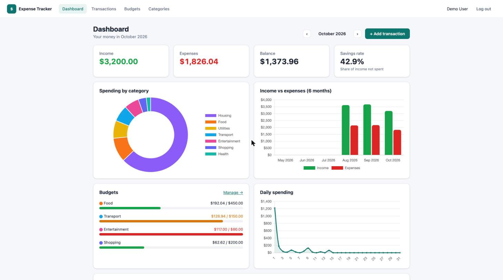
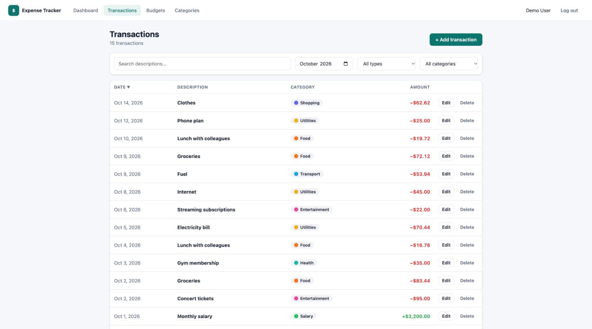

# Expense Tracker

A full-stack personal finance app: record income and expenses, group them into color-coded categories, set monthly budgets per category, and see where the money goes on a dashboard with charts. The backend is a **Spring Boot 3 REST API** secured with **JWT**, storing data in **PostgreSQL** (H2 in development) with **Flyway** migrations. The frontend is an **Angular 17** single-page app built with standalone components, signals and reactive forms, with charts from **Chart.js**. Both halves have automated tests, Docker images and a GitHub Actions CI pipeline.

> New to the codebase? Read the guide: **[docs/HOW-IT-WORKS.md](docs/HOW-IT-WORKS.md)**. It walks through the architecture, one request from click to database, security, the data model, every API endpoint and the design decisions. The source code is also heavily commented for learning.

## Features

- **Accounts**: register and log in (BCrypt-hashed passwords, stateless JWT authentication). New accounts get 9 starter categories.
- **Transactions**: create, edit and delete income and expense entries. Filter by month, type, category and description text, sort by date/amount/description, paginated server-side. Amounts are color-coded (+ green / − red).
- **Categories**: name, color and type (expense or income). Names are unique per user. A category that still has transactions cannot be deleted (HTTP 409 with a clear message).
- **Budgets**: a monthly limit per expense category, set inline. Progress bars turn **amber above 80%** and **red above 100%**.
- **Dashboard**: month picker; income, expenses, balance and savings-rate cards; spending-by-category doughnut; 6-month income-vs-expense bar chart; daily-spending line chart; budget progress; recent transactions.
- **Business rules enforced on the server**: amounts > 0 with at most 2 decimals, no future dates, transaction type must match category type, budgets only on expense categories, and every record visible only to its owner (another user's ids return 404).
- **Swagger UI** at `/swagger-ui.html`, a **demo account** with 3 months of realistic data, **Docker Compose** for the whole stack, **CI** on every push.

## Tech stack

| Layer | Technology |
|---|---|
| Backend | Java 17, Spring Boot 3.5 (Web, Data JPA, Validation, Security), Hibernate 6, jjwt 0.12 |
| Database | PostgreSQL 16 (production), H2 in PostgreSQL mode (development and tests), Flyway migrations |
| Frontend | Angular 17 (standalone components, signals, reactive forms, new `@if`/`@for` control flow), TypeScript, SCSS, Chart.js 4 |
| Testing | JUnit 5, Mockito, AssertJ, Spring MockMvc; Jasmine and Karma (headless Chrome) |
| Delivery | Docker multi-stage builds, nginx, Docker Compose, GitHub Actions |

## Quick start

### Option A: run locally (no database to install)

Requirements: Java 17+, Node 18+.

```bash
# Terminal 1: API on http://localhost:8082 (in-memory H2 database, demo data seeded)
cd backend
./mvnw spring-boot:run

# Terminal 2: web app on http://localhost:4302 (/api calls are proxied to :8082)
cd frontend
npm install
npm start
```

Open **http://localhost:4302** and click **"Use the demo account"**.

Also available in development: Swagger UI at http://localhost:8082/swagger-ui.html and the H2 console at http://localhost:8082/h2-console (JDBC URL `jdbc:h2:mem:expensetracker`, user `sa`, empty password).

> Always use the Maven wrapper `./mvnw` (it pins the Maven version) rather than a globally installed `mvn`.

### Option B: Docker (PostgreSQL + API + nginx)

```bash
docker compose up --build
```

Open **http://localhost:8092**. Data is kept in a Docker volume; `docker compose down -v` removes it.

### Run the tests

```bash
cd backend && ./mvnw -B verify                                         # 26 unit + integration tests
cd frontend && npx ng test --watch=false --browsers=ChromeHeadless      # 14 Jasmine specs
```

## Demo credentials

| Email | Password |
|---|---|
| `demo@example.com` | `password123` |

The demo account has about 3 months of transactions (salary, rent, groceries, bills…) and budgets for this month and last month. The Entertainment budget is deliberately over its limit so the red state is visible.

## Screenshots



| Transactions | Budgets |
|---|---|
|  |  |

## Project structure

```
expense-tracker/
├── backend/                 Spring Boot REST API (package com.portfolio.expensetracker)
│   ├── src/main/java/…      auth · user · security · config · common · category · transaction · budget · summary
│   ├── src/main/resources/  application.yml (dev), application-prod.yml, db/migration (Flyway SQL)
│   ├── src/test/java/…      Mockito unit tests + full-stack MockMvc integration test
│   └── Dockerfile
├── frontend/                Angular 17 app
│   ├── src/app/core/        models, auth (service, interceptor, guards), API services
│   ├── src/app/shared/      month picker, budget bar, helpers
│   ├── src/app/features/    auth, dashboard, transactions, categories, budgets pages
│   ├── proxy.conf.json      dev proxy /api → :8082
│   ├── nginx.conf           production web server + API reverse proxy
│   └── Dockerfile
├── docs/HOW-IT-WORKS.md     the in-depth guide
├── docker-compose.yml       Postgres + API + web in one command
└── .github/workflows/ci.yml build and test on every push
```

The annotated, file-by-file tree is in [docs/HOW-IT-WORKS.md §4](docs/HOW-IT-WORKS.md#4-project-structure).
